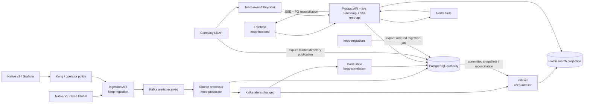

# Current service flow

The diagram below reflects Kafka-first admission, REV-34–36 worker scope and the
REV-37 repository split. PostgreSQL remains transactional authority; Kafka offsets
advance only after the required durable application proof.

`keep-domain` and `keep-contracts` are libraries/artifacts shared by the relevant
processes. They do not run as services. `keep-delivery` owns deployment and system
verification; `keep-design` owns normative design. See
[repository ownership](../specs/spec-repository-layout.md).

The preserved `keep-service-flow.png` is a **historical pre-Kafka-first image**.
Its direct SQL admission/outbox relay and generic ingress labels are superseded by
the current diagram and specifications. Retain it as design provenance only.
