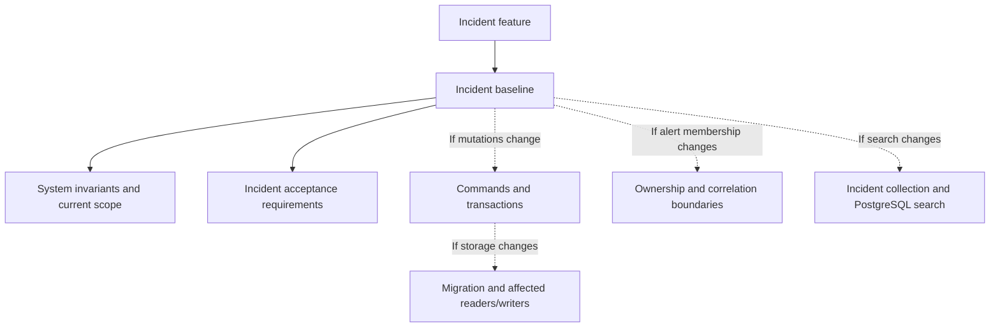

# Appchi context map

This is navigation over the existing requirements, code and evidence. It helps an
agent select a reading plan for one task. It does not introduce product policy,
replace repository instructions, or establish that a release is qualified.

**Assistant-selected implementation:** a versioned JSON catalog, a small Python
resolver, generated Markdown graph pages, and deterministic routing checks. No
retrieval service, plugin, new memory store or Obsidian configuration is required.

## Entry points and ownership

- [Task map](task-map.json) is the editable catalog. Design owns source authority,
  route triggers, section references and required/conditional relationships.
- [Visual map](map.md) and [incident route](routes/incidents.md) are generated
  navigation pages. Edit the catalog and regenerate them; do not edit them alone.
- [Routing cases](evaluation-cases.json) test the catalog and resolver. They are
  deterministic fixtures, **not behavioral evaluations of an agent**.
- [Resolver](../../appchi-delivery/scripts/context.py) and its checks belong to
  delivery. Each repository still owns its implementation and verification tools.
- Workspace and repository `AGENTS.md` files remain the native instruction
  entrypoints. Read applicable scoped instructions before editing any repository.

Catalog paths are relative to the workspace containing all eleven checkouts.
Generated links are relative Markdown links into the same files. Missing sibling
repositories are missing inputs; do not create substitute specifications.

## Select a reading plan

Start with the request, affected files, and the intended behavioral impact.
Keywords and paths provide suggestions; they do not establish semantic coverage.
Inspect the suggested route's `when` and `expand` conditions before accepting it.
Select several routes when a feature crosses boundaries.

From `appchi-delivery`, run:

```powershell
python scripts/context.py list
python scripts/context.py plan --task "add a feature to incidents"
python scripts/context.py plan --path appchi-api/src/appchi/incidents/listing.py
python scripts/context.py plan --route incident-mutations --route incident-search
python scripts/context.py read --source incident-baseline
```

The resolver accepts `--workspace ROOT` before the subcommand when checkouts are
elsewhere. `plan --format json` emits structured output. `--route` and `--path`
can be repeated. Explicit routes select the plan instead of automatic matching;
their required dependencies are still included. This lets an agent select
`ui-appearance` for dashboard spacing without loading all dashboard behavior.
It is not permission to omit requirements that the task actually affects.

Selection follows these rules:

1. Combine the selected routes, close every `requires` dependency, and deduplicate
   source references. Required relationships form an acyclic graph.
2. Read the selected sections **with their source preambles**. Corrections in a
   preamble qualify historical text farther down a specification. A heading
   selects its contents and subordinate headings; an empty section list selects
   the whole document. Whole documents are used deliberately for small guides.
3. Inspect each `expand` condition. Add the named route when the condition holds;
   conditional links are not automatically loaded. Continue into additional
   referenced requirements when they are relevant.
4. Inspect the actual code, callers, tests, local changes and affected repository
   instructions. The listed repositories are inspection candidates, not a fixed
   edit list or proof that every consumer has been found.
5. Stop initial reading once intended behavior, applicable constraints, affected
   boundaries and verification obligations are understood and material
   uncertainty is resolved. Reopen reading when implementation reveals a new
   dependency, contradiction, stale evidence or deferred feature.

If no route matches, search the system specification map, source tree and owning
repository guidance. Construct a justified reading plan and add a route only if
the pattern is reusable. An empty match is not permission to skip requirements.
Neither an output size nor a reading budget can silently truncate requirements.

The `checks` strings describe what to verify. They do not execute commands or
claim success; obtain current commands and prerequisites from the owning README
and scripts before running them.

## Example: an incident feature

For “add editable, searchable incident tags,” begin with `incidents`, then select
`incident-mutations` and `incident-search`. If implementation changes persisted
fields, HTTP schemas and controls, add `database`, `http-contract` and
`ui-behavior`. Inspect the relevant conditional relationships, including live
updates. Determine unsupported product choices, such as tag limits or editing
permissions, from authoritative decisions or the user rather than inventing them.

For “fix incidents not automatically resolving after inactivity,” the baseline
includes current worker scope. That scope defers inactivity sweeps even though
older algorithms remain in the incident specification. Routing must expose the
correction before an agent treats the observed behavior as a defect.



This diagram illustrates reading decisions. It does not define incident behavior.

## Use the same files in Obsidian

Open the existing **workspace root** as a vault so the graph can resolve links
between repositories. Do not move repositories, initialize a parent Git
repository, duplicate specifications or add submodules. No plugin is required.
This implementation does not install Obsidian or create `.obsidian` settings.

Open [the generated map](map.md), follow a route such as
[Incidents](routes/incidents.md), and use its local graph to inspect neighboring
routes and source documents. A global graph shows the wider documentation network.
Obsidian's graph works at file level; section links open the relevant heading.
Required and conditional meanings are written in route pages and diagram labels;
the standard graph does not enforce those meanings or automatically highlight a
task's required documents. The resolver's plan is the explicit reading selection.

Regenerate and check from `appchi-delivery`:

```powershell
python scripts/context.py render
python scripts/context.py check
```

From `appchi-design`, the equivalent renderer is
`python ../appchi-delivery/scripts/context.py render`. Generated files are
reviewable artifacts; retain catalog and generated navigation together.
Design's `python scripts/check_docs.py`, which also runs in design CI, checks that
every catalog section in a design-owned source exists exactly once, so renaming
or duplicating such a heading fails in this repository. Sources in sibling
repositories and the remaining catalog checks still require the delivery gate.

## Authority, freshness and task memory

Sources carry an authority category: `instruction`, `normative`, `scope`,
`verification`, `implementation`, `evidence`, or `historical`. These labels aid
navigation; they do not grant authority to arbitrary content or supersede the
normal instruction hierarchy. Current explicit user decisions and applicable
scope corrections govern historical examples. Verification requirements describe
what must be checked; evidence describes what was checked for particular code and
environment revisions.

Use current working files, including authorized uncommitted changes, and record
the actual revisions and dirty state when making a consequential assessment.
Generated-page freshness shows whether navigation matches its inputs; it is not
proof that a source is semantically current or a capability is qualified. Recheck
source references after changes, and inspect the dates/revisions behind evidence.

For substantial work, keep the objective, selected routes, authoritative source
references, decisions, completed verification and unresolved dependencies in the
existing task checkpoint. On resume, reconcile that checkpoint with current
instructions, files and Git state. A checkpoint never overrides a changed source.

## Maintain and evaluate the layer

When a task exposes missing context, update the smallest relevant route and add
a representative case. Keep requirements in their existing authoritative homes.
Avoid adding generic keywords or repository-wide globs that select unrelated
domains. Keep appearance-only work separate from behavior and keep incident
PostgreSQL search separate from alert Elasticsearch projection.

`check` validates references and section headings, route relationships, generated
navigation and the routing cases. These checks can detect structural errors and
known selection regressions. They cannot prove that an agent understood the
requirements, discovered every dependency, or implemented the task correctly.

Before claiming improved efficiency, compare the current and proposed setup on
real representative tasks with the same model, client, repository revisions and
inputs. Measure requirement coverage, missed dependencies, task acceptance,
unnecessary reading, tokens, time and human corrections across repeated trials.
Include deferred behavior and resume cases. No performance improvement is claimed
by adding this catalog or passing its deterministic checks.

This approach applies the progressive-reading and repository-navigation ideas in
[OpenAI's harness engineering account](https://openai.com/index/harness-engineering/)
and [Anthropic's context engineering guidance](https://www.anthropic.com/engineering/effective-context-engineering-for-ai-agents).
[Obsidian's graph documentation](https://help.obsidian.md/plugins/graph) explains
the optional human browsing surface. These references inform the implementation;
Appchi specifications remain the product authority.
