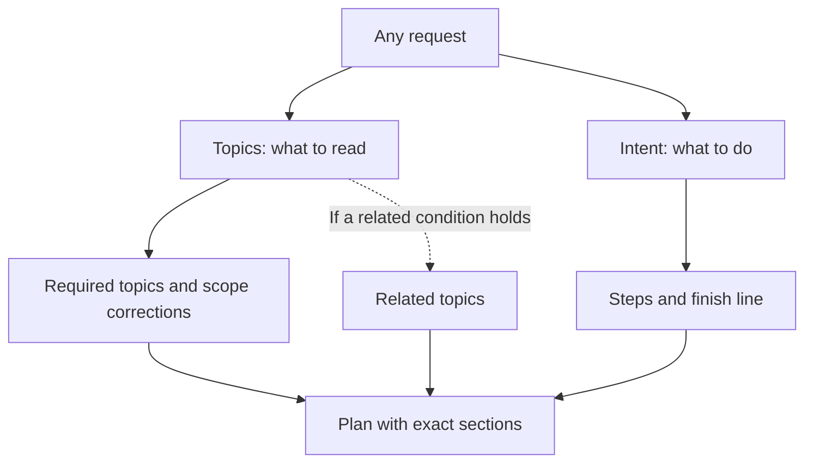

# Keep context map

This is navigation over the existing requirements, code and evidence. It helps an
agent reach the right sources for any request — a question, a change, a bug
investigation, a review or an operation — and says what to do with them. It does
not introduce product policy, replace repository instructions, or establish that a
release is qualified.

**Assistant-selected implementation:** a versioned JSON catalog of topics and
intents, a small Python resolver, a generated topic index in the workspace
`AGENTS.md`, generated Markdown pages and deterministic routing checks. No hook,
retrieval service, database, plugin, new memory store or Obsidian configuration is
required. The 2026-11-01 redesign replaced change-oriented routes with subject
topics; see the [design register](../decisions/design-register.md#context-topics-and-intents--2026-11-01).

## Entry points and ownership

- [Task map](task-map.json) is the editable catalog. Design owns source authority,
  topics, intents, section references and required/related relationships.
- The topic index inside the workspace [AGENTS.md](../../keep-delivery/workspace/AGENTS.md),
  the [visual map](map.md) and the topic pages such as [incidents](topics/incidents.md)
  are generated. Edit the catalog and regenerate them; do not edit them alone.
- [Routing cases](evaluation-cases.json) test the catalog and resolver. They are
  deterministic fixtures, **not behavioral evaluations of an agent**.
- [Resolver](../../keep-delivery/scripts/context.py) and its checks belong to
  delivery. Each repository still owns its implementation and verification tools.
- Workspace and repository `AGENTS.md` files remain the native instruction
  entrypoints. Read applicable scoped instructions before editing any repository.

Catalog paths are relative to the workspace containing all eleven checkouts.
Generated links are relative Markdown links into the same files. Missing sibling
repositories are missing inputs; do not create substitute specifications.

## Intents say what to do

An intent is the kind of request. It decides which topic fields a plan shows, adds
any Keep-specific reading, and lists steps and a finish line. Generic procedure
stays in the shared eng-* skills; intents only point to them.

| Intent | For | Adds |
|---|---|---|
| `question` | Understanding or answering | Orientation sections, code locations, evidence; an answer separates specified, implemented, deferred and verified behavior, with citations |
| `change` | Adding or modifying | Required and related topics, repositories, change checks and the verification workflow |
| `review` | Checking a diff | Acceptance scenarios for touched areas, callers, change checks |
| `investigate` | Unexpected behavior | Current worker scope first, then code and dated evidence; a fix continues as `change` |
| `operate` | Running, releasing, recovering | Runbooks and authorization boundaries |

An unclear request starts as `question`. Without `--intent`, the resolver infers one
from cue words, in this order. Review and failure cues anywhere win, except a failure
inside a supposition ("If the indexer fails, how …?"). Next, a sentence that opens,
after filler such as "please" or "can you", with an instruction decides: a cue of a
non-default intent or an intent's `openers` ("Make …", "Plan …", "Let users …"; the
longest opener wins, so "Show me …" is a question while "Show …" is a change). Then
any sentence ending in a question mark makes it a `question`; otherwise the earliest
cue decides. The plan reports the intent and why.

## Topics say what to read

A topic is a subject of the system, described by what it covers rather than by a
kind of change. Each topic has a one-line `covers` description used in the index,
two to four `ask_like` examples, `aliases` for matching, `orientation` sources to
read first, authoritative `sources`, `evidence` sources for current status,
mandatory `requires` topics, `related` topics with the condition for reading each,
the `repositories` and `path_globs` where the code lives, and change `checks`.
Areas group topics in the index and map.

## Get a plan

Pick the intent and topics from the index by meaning, then from `keep-delivery`:

```powershell
python scripts/context.py list
python scripts/context.py plan --intent question --topic alert-pipeline --topic recovery --content
python scripts/context.py plan --task "Why does a dashboard count differ from the alert list?"
python scripts/context.py plan --path keep-api/src/keep/incidents/listing.py
python scripts/context.py find "scheduler cadence"
python scripts/context.py read --source incident-baseline
```

The resolver accepts `--workspace ROOT` before the subcommand when checkouts are
elsewhere. `plan --format json` emits structured output; `--topic` and `--path`
can be repeated, and `--route` remains an alias of `--topic`. `--content` includes
the selected text so one command replaces the separate `read` calls; nothing is
truncated. A document's preamble, and any section that two selected sources share,
appears once under the first source that reads it; later sources name the line
ranges shown above.

Selection follows these rules:

1. Explicit topics select the plan; word and path matches then appear only as
   suggestions. Without explicit topics, `--path` globs always select their topics
   and `--task` words select at most three more, ranked by distinct alias matches.
   Matching compares conservatively stemmed whole words and phrases, never prefixes,
   so "correlated" meets "correlation" while "incidental" stays distinct from
   "incident". Matching does not establish semantic coverage.
2. Combine the selected topics, close every `requires` dependency, and deduplicate
   sources. Required relationships form an acyclic graph. Sources are ranked:
   orientation (when the intent shows it), the requested topics' own sources,
   `scope` sources from required topics (current-scope corrections are never
   background), intent additions, the remaining `background` from topics that are
   only required, then evidence (when the intent shows it). A source that lists
   `intents` is procedure for those intents (the agent-workflow policies, the
   migration guide and the release-artifact runbook serve `change` and `operate`);
   other intents' plans keep it as a binding pointer without its text.
3. Read the selected sections **with their source preambles**. Corrections in a
   preamble qualify historical text farther down a specification. A section that
   a later decision changes also carries a **Current scope** note under its heading.
   The catalog's `scope_sections` add a document's scope-correction sections to
   every partial read of that document; the verification plan's REV-34/35 scope
   paragraphs and "Worker scope correction" travel this way. A heading selects its
   contents and subordinate headings; an empty section list selects the whole document.
4. Inspect each related condition and add the named topic when it holds. Continue
   into additional referenced requirements when they are relevant.
5. Inspect the actual code, callers, tests, local changes and affected repository
   instructions. Listed repositories are inspection candidates, not a fixed edit
   list or proof that every consumer has been found.
6. Stop initial reading once intended behavior, applicable constraints, affected
   boundaries and verification obligations are understood and material
   uncertainty is resolved. Reopen reading when work reveals a new dependency,
   contradiction, stale evidence or deferred feature.

When no topic matches, the plan is `unresolved` (exit 2) and lists `find`
candidates: headings across the specifications, verification plan, decisions,
architecture and delivery docs and status records that share words with the
request, with their authority and the topics that cite them. Construct a justified
reading plan from them and add a topic only if the pattern is reusable. An empty
match is not permission to skip requirements, and no output size or reading budget
can silently truncate requirements.

The `checks` strings describe what to verify. They do not execute commands or
claim success; obtain current commands and prerequisites from the owning README
and scripts before running them.

## Examples

For “how does the processor handle replay?”, pick `question` with `alert-pipeline`
and `recovery`. The plan starts with the architecture overview, then the Kafka
pipeline's authority, admission and fencing sections, the recovery boundaries and
the worker scope preamble, and tells the agent to separate specified, implemented,
deferred and verified behavior.

For “add editable, searchable incident tags,” pick `change` with `incidents`,
`incident-mutations` and `incident-search`. If persisted fields, HTTP schemas and
controls change, add `database`, `http-contract` and `ui-behavior` from the related
conditions, including live updates. Determine unsupported product choices, such as
tag limits or editing permissions, from authoritative decisions or the user.

For “incidents are not resolving after inactivity,” the inferred intent is
`investigate`, which reads current worker scope first. That scope defers inactivity
sweeps even though older algorithms remain in the incident specification, so the
behavior may be deferred rather than broken.



This diagram illustrates reading decisions. It does not define product behavior.

## Use the same files in Obsidian

Open the existing **workspace root** as a vault so the graph can resolve links
between repositories. Do not move repositories, initialize a parent Git
repository, duplicate specifications or add submodules. No plugin is required.
This implementation does not install Obsidian or create `.obsidian` settings.

Open [the generated map](map.md), follow a topic such as
[Incidents](topics/incidents.md), and use its local graph to inspect neighboring
topics and source documents. Obsidian's graph works at file level; section links
open the relevant heading. Required and related meanings are written in topic
pages; the standard graph does not enforce them. The resolver's plan is the
explicit reading selection.

Regenerate and check from `keep-delivery`:

```powershell
python scripts/context.py render
python scripts/context.py check
```

`render` writes the map, the topic pages and the index block between the markers in
`keep-delivery/workspace/AGENTS.md`; it refuses to overwrite unowned files and
reports stale generated pages for explicit removal. Generated files are reviewable
artifacts; retain catalog and generated navigation together. Design's
`python scripts/check_docs.py`, which also runs in design CI, checks that every
catalog section and scope section in a design-owned source exists exactly once.
Sources in sibling repositories and the remaining checks require the delivery gate.
`check` also reports how many level-2 specification sections some topic's sources
reach; `check --unowned` lists the rest. This is a report, not a gate: agents choosing
by meaning still search the specifications, so a gap is closed when a recurring
request needs it.

## Authority, freshness and task memory

Sources carry an authority category: `instruction`, `normative`, `scope`,
`verification`, `implementation`, `evidence`, or `historical`. These labels aid
navigation; they do not grant authority to arbitrary content or supersede the
normal instruction hierarchy. Current explicit user decisions and applicable
scope corrections govern historical examples. Verification requirements describe
what must be checked; evidence describes what was checked for particular code and
environment revisions.

Use current working files, including authorized uncommitted changes, and record
the actual revisions and dirty state when making a consequential assessment.
Generated-page freshness shows whether navigation matches its inputs; it is not
proof that a source is semantically current or a capability is qualified. Recheck
source references after changes, and inspect the dates/revisions behind evidence.

For substantial work, keep the objective, intent, selected topics, authoritative
source references, decisions, completed verification and unresolved dependencies
in the existing task checkpoint. On resume, reconcile that checkpoint with current
instructions, files and Git state. A checkpoint never overrides a changed source.

## Maintain and evaluate the layer

When a request exposes missing context, update the smallest relevant topic and add
a representative case. Keep requirements in their existing authoritative homes;
`covers` lines stay at most 160 characters and describe subjects, not rules. Avoid
aliases so generic that they select unrelated domains: keep appearance-only work
separate from behavior and incident PostgreSQL search separate from alert
Elasticsearch projection. The index must stay within 40 lines.

`check` validates references and section headings, scope sections, topic and intent
relationships, the generated pages and index, and the routing cases, including
question, investigation, review, operation and unresolved requests. These checks
detect structural errors and known selection regressions. They cannot prove that
an agent understood the requirements, discovered every dependency, or completed
the request correctly.

Before claiming improved efficiency, compare the current and proposed setup on
real representative requests with the same model, client, repository revisions
and inputs. Measure requirement coverage, missed dependencies, acceptance,
unnecessary reading, tokens, time and human corrections across repeated trials.
Include questions, deferred behavior and resume cases. No performance improvement
is claimed by adding this catalog or passing its deterministic checks. The
[2026-10-24 planning trials](../../keep-delivery/qualification/context-eval-2026-10-24/results.md)
of the earlier route layer showed no token saving, and the
[2026-11-01 paired trial](../../keep-delivery/qualification/context-eval-2026-11-01/results.md)
of routes against topics showed level quality, fewer tool calls and slightly more
tokens, with one run per cell.

This approach applies the progressive-reading and repository-navigation ideas in
[OpenAI's harness engineering account](https://openai.com/index/harness-engineering/)
and [Anthropic's context engineering guidance](https://www.anthropic.com/engineering/effective-context-engineering-for-ai-agents).
[Obsidian's graph documentation](https://help.obsidian.md/plugins/graph) explains
the optional human browsing surface. These references inform the implementation;
Keep specifications remain the product authority.
