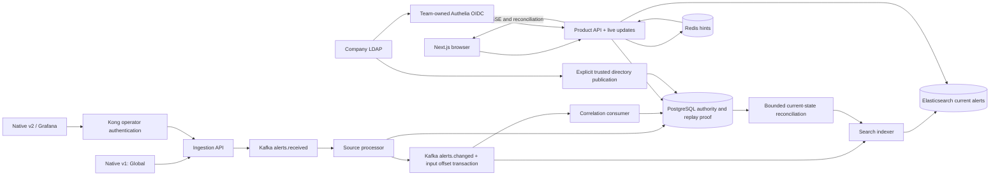

# Keep system design

**Later user decision — 2026-09-30 (REV-35):** automatic directory synchronization is nice-to-have and is not deployed. Explicit trusted publication supplies identity updates; the five-minute LDAP-change propagation target is deferred. See [worker scope](spec-worker-scope.md#4-directory-synchronization-is-nice-to-have).

**Later scope correction — 2026-09-30:** [Worker scope](spec-worker-scope.md) (REV-34) supersedes timer-driven maintenance release, automatic assignment cleanup, inactivity/retention worker deployment and asynchronous operator provisioning below. Earlier automation algorithms are retained as deferred design references; unaffected authorization, explicit commands, history access and recovery safeguards remain normative.

Keep is an internal, multi-tenant alerts management system. It receives v1/v2 alerts, maintains one evolving row per logical alert with source and activity history, and provides CEL feeds, shared presets, incidents, automatic correlation, maintenance suppression and shared count dashboards.

This specification set defines the initial release. Application implementation and production qualification are separate work; [Delivery readiness](https://github.com/keep-alert-operations/keep-delivery/blob/main/status/delivery-readiness.md) records the required service inputs and evidence.

## Specification map

**Current scope (REV-35):** The identity row's five-minute access-enforcement target is deferred with directory polling; see [worker scope](spec-worker-scope.md#4-directory-synchronization-is-nice-to-have). The document ownership in this map remains normative.

Each contract has one authoritative home. Read the relevant domain document together with shared contracts when implementing a feature. Domain-specific rules override generic defaults where explicitly stated; illustrative examples and decision history never expand an input schema.

| Document | Authoritative content |
|---|---|
| [Alerts](spec-alert-operations.md) | Native field inventory, validation, identity, ingestion, lifecycle, occurrences, notes, retention and alert API behavior. |
| [Kafka-first alert pipeline](spec-kafka-alert-pipeline.md) | Admission, transactional Kafka source processing, gateway policy, temporal boundaries, correlation triggers, search reconciliation and cutover. |
| [Alerts and history technical design](spec-alert-history-technical.md) | CEL semantics/execution, alert storage, ordered pipeline, projection, feed/history cursors, live updates, purge and rebuild. |
| [Tenants and access](spec-tenant-access.md) | Tenant lifecycle, role matrix, grants, directory selection, access audit and API contracts. |
| [Identity configuration](spec-identity-configuration.md) | Team-owned Authelia OIDC, LDAP membership, username/password sign-in, sessions, five-minute access enforcement and outage behavior. |
| [Operators, API keys and Grafana](spec-operator-operations.md) | Operator lifecycle, credentials, ingress authentication and remote provisioning. |
| [Incidents](spec-incident-operations.md) | Manual/automatic incident behavior, ownership, activity, notes, inactivity, retention and period reports (REV-53). |
| [Correlation rules](spec-correlation-rules.md) | Conditions, grouping, transition evidence, reset boundaries, arbitration and coordination. |
| [Presets](spec-preset-operations.md) | Shared saved feeds, editing, validation, history and dashboard references. |
| [Maintenance](spec-maintenance-operations.md) | One-time windows, temporal proof, overlapping causes, scheduling, APIs and history. |
| [Dashboards](spec-dashboard-operations.md) | Saved panel layout, count batches, editing, drill-through, APIs and history. |
| [Shared system contracts](spec-system-completion.md) | Common UI/HTTP/errors, non-alert schemas, incident/correlation routes, locking, security and workloads. |
| [Reliability and operations](spec-reliability-operations.md) | SLOs, capacity objectives, backpressure, failures, telemetry and recovery. |

Supporting records are separate from runtime contracts:

- [Verification plan](../verification/verification-plan.md): required acceptance scenarios.
- [Delivery readiness](https://github.com/keep-alert-operations/keep-delivery/blob/main/status/delivery-readiness.md): service bindings, CI, rollout, runbooks and DEL-01–DEL-08 evidence.
- [Design register](../decisions/design-register.md): coverage of the 55 original issues and corrections from this review.
- [Decision history](../decisions/design-decisions-2026-09-22.md): provenance of the final all-subject choices; current specifications govern details.

The user delegated completion of all remaining design decisions on 2026-09-22. Specifications combine preserved user requirements with assistant-selected details; explicitly marked user choices take precedence. New choices made during this review are labelled in the design register.

## Product model

A **tenant** is an independent authorization and data scope. Specific tenants receive authenticated v2 alerts through their operators. The fixed **Global** tenant receives unauthenticated v1 alerts. Every eligible signed-in company user has edit access to Global; only global super-admins administer it. Specific tenants use LDAP user/team grants with highest-role precedence: admin, edit, then view. Tenant deletion and disablement are unavailable.

An **operator** permanently belongs to one tenant and represents a v2 sender. Kong/API keys establish its immutable identity and routing. Managed operators require verified setup in the shared company Grafana. Legacy v1 operator strings are source data, not managed operators or authorization.

An **alert** is a logical identity, not a delivery. Source events update its permitted fields and lifecycle. Resolution followed by firing starts another occurrence on the same row. V1 and v2 identities are separate. Assignment, notes and incident membership are management data; sources cannot overwrite them as arbitrary input. Assignment acknowledges responsibility: the visible status is Firing for an unassigned firing alert, Acknowledged for an assigned firing alert, and Resolved for any resolved alert. Assignment is the sole current ownership control; there is no separate acknowledgement action. Alert operations section 17 defines transitions and retained compatibility evidence.

**Suppression** is independent of firing/resolved lifecycle. V2 source suspension and maintenance contribute separate causes. Suppressed alerts remain ingested, stored and available through explicit feed inclusion, but ordinary feed counts and automatic correlation exclude them.

A **preset** saves tenant-shared CEL, sorting, columns and optional grouping. A **dashboard** contains panels referencing current saved presets and showing exact logical-alert counts. Neither saves an independent time range; time predicates use CEL. Resolved alerts remain eligible for feeds/counts unless the query excludes them.

An **incident** has immutable severity, independent status and assignment, notes, cycles and links. An alert has at most one active incident owner; resolved links remain historical. Manual linking may include resolved or suppressed alerts. Resolving an incident does not resolve its alerts.

A **correlation rule** creates an incident when all named conditions have fresh eligible evidence within its window, then adds eligible alerts matching any condition to that context's active incident. Earlier-created rules win competing automatic claims. Repeats do not refresh evidence; resets, expiry and manual ownership constrain reuse.

A **maintenance window** suppresses qualifying arrivals/transitions during a one-time interval. It does not scan existing matching alerts into coverage at creation. Overlapping coverage is combined without dropping deliveries or altering lifecycle.

## Architecture and authority

Backend services use Python/FastAPI; the UI uses Next.js/TypeScript. Workloads run in OpenShift. Modules share a transactional domain model. [Current worker scope](spec-worker-scope.md) defines active roles and deferred automation; operator provisioning runs during backend HTTP requests and live hint publishing runs as a Product API background task.

| Store/service | Responsibility | Consistency boundary |
|---|---|---|
| PostgreSQL | Current domain state/history, authorization, immutable source replay proof, command results and non-alert jobs | Source application and product commands commit here; ingress has no database dependency. |
| Elasticsearch | Rebuildable current-alert/current-note search projection | May lag; a searchable watermark proves visibility. Never authorizes access or supplies authoritative history. |
| Kafka | Self-contained received alerts and transactional changed transport | Broker acknowledgement precedes 202. Delivery UUID/proof prevents duplicate application; per-key source order and per-tenant changed order govern their respective consumers. Retention can lose unprocessed accepted records. |
| Redis | Low-latency invalidation hints | Loss is repaired by PostgreSQL generation reconciliation and polling. |
| Authelia / LDAP | Human authentication (Authelia binds LDAP read-only) / company identity and nested membership read by Keep's `ldap.py` | Keep combines a valid session, accepted directory evidence and current product grants on every authorization decision. The IdP supplies no group/role claims. |
| Kong / Grafana | Operator authentication / shared remote alert delivery configuration | Kong Key Auth plus Keep policy verifies credential/tenant/generation; all-node proof gates the remote saga. Ingress verifies private mTLS context. |
| Protected recovery evidence | Minimal retirement, revocation and replay fences surviving database rollback | Restore and physical cleanup are gated by the independently supplied durability contract. |

### Admission and processing

1. Capture ingress UTC, validate native fields or Grafana transport, and use fixed Global or trusted Kong tenant routing without PostgreSQL.
2. Publish valid batch members concurrently to `alerts.received`, keyed by tenant/application/key. Reuse an internal delivery UUID across three attempts; return per-item 202 only on broker acknowledgement.
3. Consume each source partition in append order. Commit alert/history/suppression and immutable result proof once in PostgreSQL; then transactionally publish `alerts.changed` and commit the input offset in Kafka. A replay retrieves the same bytes without reapplying state.
4. Correlation consumes changed events in tenant Kafka order, uses ingress UTC for eligibility, and checks current state before actions. Maintenance effects use bounded inline transactions; manual resolve atomically removes active evidence.
5. Search consumes a separate group and reconciles authoritative PostgreSQL current state, including missed manual/maintenance/relationship/deletion notifications. A completed bounded scan establishes a lower-bound searchable watermark.
6. SSE invalidates scoped views; clients refetch and show lag/errors. Infrastructure retention, topology and recovery remain with the dedicated teams.

Terminal post-202 business conflicts are recorded internally and advance the partition. Transient failures retry without advancing. The complete protocol, limitations and assistant-selected decisions are in [Kafka-first pipeline](spec-kafka-alert-pipeline.md).

### Human reads and writes

Sign-in uses username and password through backend OIDC authorization code flow with PKCE. Browser requests use an opaque protected session cookie; tokens remain server-side. Product APIs reauthorize tenant scope and nested references. Automatic directory refresh and its five-minute LDAP-change propagation target are nice-to-have under REV-35. Explicit trusted publication supplies identity updates; last-known trusted identity data, known revocations, current grants and session expiry still apply.

Alert feeds/counts query Elasticsearch under tenant scope, CEL, transient text filtering and suppression policy. Alert detail/history and incident/configuration reads use PostgreSQL. Feed pagination uses a five-minute search snapshot; other collection and history cursor semantics are specified per resource.

Mutations carry command identity and expected revisions, commit authoritative results and history atomically, and return those results immediately. A retry never invents a new command after an uncertain timeout. Queued source work does not block manual commands and may change an alert again afterward. Authorization guards precede domain locks; external service calls occur outside transactions.

Navigation starts at the last accessible tenant from the session, otherwise Global Feed. The 2026-10-11 user correction names the alert-query page Feed; existing alert resource URLs and API contracts remain. Shared views refresh through SSE plus reconciliation. Drafts remain in tab memory across ordinary conflicts and are cleared when access is lost. Search outages, pending maintenance and indexing lag are visible rather than presented as empty results.

## Cross-system invariants

- Immutable UUIDs identify resources. Names may be reused only under their resource's uniqueness and deletion rules; reuse never transfers old links, grants or history.
- Every tenant reference, query, command, cursor and live message is scoped and reauthorized. Assignment and resource creation confer no extra permissions.
- Effective changes commit state, history, progress and proof together; alert search notifications after non-source commits are best effort. No-op retries do not create synthetic activity.
- Automatic correlation uses genuine eligible transitions and original qualifying times. Delayed work cannot revive expired evidence or treat unknown state as a false-to-true transition.
- Active ownership, overlapping suppression and preset/dashboard references are enforced transactionally. A partially evaluated automatic attachment set is never presented as complete.
- A visible count is exact for its stated query/snapshot. Errors and stale values retain provenance; failed searches never become zero.
- Inactivity sweeps are deferred. Existing activity anchors remain; no timer automatically resolves alerts or incidents.
- Automatic retention sweeps are deferred. Existing history-access windows and prior retirement/replay fences remain; the [retention matrix](spec-system-completion.md#19-unified-retention-and-configuration-history) remains the future cleanup design.
- Retirement preserves minimal references and replay fences. Recovery never restores deleted content, revoked credentials or old sessions from stale backups.
- Service outages isolate affected capabilities. PostgreSQL failure blocks processing/commands but not healthy Kafka admission; Kafka failure blocks acknowledged admission. Search/Redis failures isolate their affected capabilities.

## Capacity and ownership

**Current scope (REV-34):** The five-second render objective no longer covers maintenance expiry, because ending a window releases nothing; see [worker scope](spec-worker-scope.md#1-maintenance-without-a-scheduler). Other capacity objectives and ownership below remain normative.

The sustained ingestion requirement is 250 deliveries/second company-wide, including all traffic in one tenant or Global; normal traffic is about 66.7/second. Selected normal-operation p99 objectives are one second for admission and authoritative commands, two seconds for searches/counts, and five seconds for incoming/maintenance changes to render. Path availability targets are 99.9% over rolling 30 days. [Reliability](spec-reliability-operations.md) defines eligibility, measurement, stress/recovery workloads and Kafka admission safeguards.

These targets do not establish measured capacity. Before enabling affected capabilities, qualify combined workloads and record numeric application budgets, connection/resource allocations and service capability evidence.

The user's team owns Keep and Authelia configuration/operation (REV-73 replaced Keycloak with the single-binary Authelia OIDC provider for air-gapped operability). Dedicated teams own LDAP, PostgreSQL, Elasticsearch, Kafka, Redis, OpenShift, Kong, Grafana and their infrastructure policy, HA, backups, retention, allocation and service recovery. Keep defines its schemas, client behavior and product data lifetimes, then validates the supplied service contracts. Installed versions, endpoints, credentials, named contacts and actual recovery guarantees belong in the environment manifest.

## Initial-release exclusions

No tenant deletion/disablement, custom roles or resource-specific ACLs; no private presets/dashboards or persisted personal table preferences; no recurring maintenance; no correlation count thresholds, sequence/branching language, configurable priority or automatic overlap analysis; no incident acknowledgement/owning team; no product notifications, attachments, bulk export or public sharing; no enriched historical import or v1/v2 identity merge; no full event-sourcing architecture or full-history Elasticsearch index.

These exclusions define scope rather than unresolved gaps.

Current repository and deployment ownership: [REV-37 repository layout](spec-repository-layout.md).
