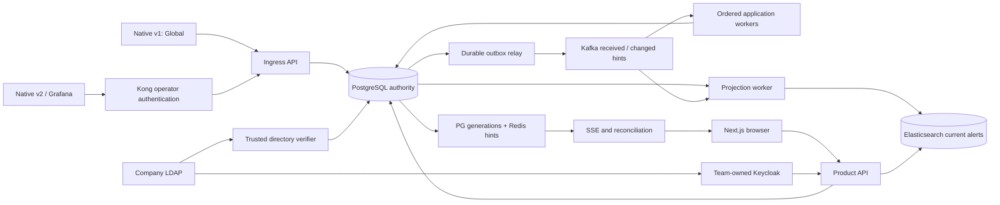

# Appchi system design

Appchi is an internal, multi-tenant alerts management system. It receives v1/v2 alerts, maintains one evolving row per logical alert with source and activity history, and provides CEL feeds, shared presets, incidents, automatic correlation, maintenance suppression and shared count dashboards.

This specification set defines the initial release. Application implementation and production qualification are separate work; [Delivery readiness](./delivery-readiness.md) records the required service inputs and evidence.

## Specification map

Each contract has one authoritative home. Read the relevant domain document together with shared contracts when implementing a feature. Domain-specific rules override generic defaults where explicitly stated; illustrative examples and decision history never expand an input schema.

| Document | Authoritative content |
|---|---|
| [Alerts](./spec-alert-operations.md) | Native field inventory, validation, identity, ingestion, lifecycle, occurrences, notes, retention and alert API behavior. |
| [Alerts and history technical design](./spec-alert-history-technical.md) | CEL semantics/execution, alert storage, ordered pipeline, projection, feed/history cursors, live updates, purge and rebuild. |
| [Tenants and access](./spec-tenant-access.md) | Tenant lifecycle, role matrix, grants, directory selection, access audit and API contracts. |
| [Identity configuration](./spec-identity-configuration.md) | Team-owned Keycloak, LDAP membership, username/password sign-in, sessions, five-minute access enforcement and outage behavior. |
| [Operators, API keys and Grafana](./spec-operator-operations.md) | Operator lifecycle, credentials, ingress authentication and remote provisioning. |
| [Incidents](./spec-incident-operations.md) | Manual/automatic incident behavior, ownership, activity, notes, inactivity and retention. |
| [Correlation rules](./spec-correlation-rules.md) | Conditions, grouping, transition evidence, reset boundaries, arbitration and coordination. |
| [Presets](./spec-preset-operations.md) | Shared saved feeds, editing, validation, history and dashboard references. |
| [Maintenance](./spec-maintenance-operations.md) | One-time windows, temporal proof, overlapping causes, scheduling, APIs and history. |
| [Dashboards](./spec-dashboard-operations.md) | Saved panel layout, count batches, editing, drill-through, APIs and history. |
| [Shared system contracts](./spec-system-completion.md) | Common UI/HTTP/errors, non-alert schemas, incident/correlation routes, locking, security and workloads. |
| [Reliability and operations](./spec-reliability-operations.md) | SLOs, capacity objectives, backpressure, failures, telemetry and recovery. |

Supporting records are separate from runtime contracts:

- [Verification plan](./verification-plan.md): required acceptance scenarios.
- [Delivery readiness](./delivery-readiness.md): service bindings, CI, rollout, runbooks and DEL-01–DEL-08 evidence.
- [Design register](./design-register.md): coverage of the 55 original issues and corrections from this review.
- [Decision history](./design-decisions-2026-09-22.md): provenance of the final all-subject choices; current specifications govern details.

The user delegated completion of all remaining design decisions on 2026-09-22. Specifications combine preserved user requirements with assistant-selected details; explicitly marked user choices take precedence. New choices made during this review are labelled in the design register.

## Product model

A **tenant** is an independent authorization and data scope. Specific tenants receive authenticated v2 alerts through their operators. The fixed **Global** tenant receives unauthenticated v1 alerts. Every eligible signed-in company user has edit access to Global; only global super-admins administer it. Specific tenants use LDAP user/team grants with highest-role precedence: admin, edit, then view. Tenant deletion and disablement are unavailable.

An **operator** permanently belongs to one tenant and represents a v2 sender. Kong/API keys establish its immutable identity and routing. Managed operators require verified setup in the shared company Grafana. Legacy v1 operator strings are source data, not managed operators or authorization.

An **alert** is a logical identity, not a delivery. Source events update its permitted fields and lifecycle. Resolution followed by firing starts another occurrence on the same row. V1 and v2 identities are separate. Acknowledgement, assignment, notes and incident membership are management data; sources cannot overwrite them as arbitrary input.

**Suppression** is independent of firing/resolved lifecycle. V2 source suspension and maintenance contribute separate causes. Suppressed alerts remain ingested, stored and available through explicit feed inclusion, but ordinary feed counts and automatic correlation exclude them.

A **preset** saves tenant-shared CEL, sorting and columns. A **dashboard** contains panels referencing current saved presets and showing exact logical-alert counts. Neither saves an independent time range; time predicates use CEL. Resolved alerts remain eligible for feeds/counts unless the query excludes them.

An **incident** has immutable severity, independent status and assignment, notes, cycles and links. An alert has at most one active incident owner; resolved links remain historical. Manual linking may include resolved or suppressed alerts. Resolving an incident does not resolve its alerts.

A **correlation rule** creates an incident when all named conditions have fresh eligible evidence within its window, then adds eligible alerts matching any condition to that context's active incident. Earlier-created rules win competing automatic claims. Repeats do not refresh evidence; resets, expiry and manual ownership constrain reuse.

A **maintenance window** suppresses qualifying arrivals/transitions during a one-time interval. It does not scan existing matching alerts into coverage at creation. Overlapping coverage is combined without dropping deliveries or altering lifecycle.

## Architecture and authority

Backend services use Python/FastAPI; the UI uses Next.js/TypeScript. Workloads run in OpenShift. Modules share a transactional domain model; separate worker roles scale processing without changing authority or transaction boundaries.

| Store/service | Responsibility | Consistency boundary |
|---|---|---|
| PostgreSQL | Current domain state, source/history, authorization, receipts, proofs, jobs, outboxes and progress | Successful admission/commands require the authoritative transaction to commit. |
| Elasticsearch | Rebuildable current-alert/current-note search projection | May lag; a searchable watermark proves visibility. Never authorizes access or supplies authoritative history. |
| Kafka | Durable alert-pipeline transport and wake-ups | PostgreSQL identities, ordering and checkpoints prevent duplicate effects and recover missed delivery. |
| Redis | Low-latency invalidation hints | Loss is repaired by PostgreSQL generation reconciliation and polling. |
| Keycloak / LDAP | Human authentication / company identity and nested membership | Appchi combines a valid session, accepted directory evidence and current product grants on every authorization decision. |
| Kong / Grafana | Operator authentication / shared remote alert delivery configuration | Appchi rechecks current credential state; remote provisioning uses a durable verified saga. |
| Protected recovery evidence | Minimal retirement, revocation and replay fences surviving database rollback | Restore and physical cleanup are gated by the independently supplied durability contract. |

### Admission and processing

1. Validate the native payload or Grafana adapter result and resolve routing. V1 always routes to Global; v2 uses the authenticated operator's tenant.
2. Resolve request/item retry identities. Atomically reserve backlog capacity and persist the admissible batch subset, its receipt and increasing tenant admission order in PostgreSQL.
3. Return 202 after commit. The outbox relay publishes wake-ups; pending-work scans recover missed wake-ups.
4. Apply source items in tenant order. Commit state, occurrences, history, suppression evidence, correlation input and projection work together. Source order and semantic change order are distinct.
5. Correlation uses durable before/after evidence, current-time eligibility and the shared coordinator to commit complete incident/ownership changes.
6. Project full committed snapshots to Elasticsearch. Publish view progress only after search visibility is proven. SSE invalidates scoped views; clients refetch and retain explicit lag/error state.

Source failures cannot skip accepted predecessors. Ten consecutive failures block that tenant's source head until the audited retry API resumes the same item after repair. Projection/relay retries remain automatic.

### Human reads and writes

Sign-in uses username and password through backend OIDC authorization code flow with PKCE. Browser requests use an opaque protected session cookie; tokens remain server-side. Product APIs reauthorize tenant scope and nested references. Directory changes, including account disablement and nested super-admin loss, target enforcement within five minutes during normal operation. Refresh outages retain last-known trusted identity data; known revocations, current grants and session expiry still apply.

Alert feeds/counts query Elasticsearch under tenant scope, CEL, transient text filtering and suppression policy. Alert detail/history and incident/configuration reads use PostgreSQL. Feed pagination uses a five-minute search snapshot; other collection and history cursor semantics are specified per resource.

Mutations carry command identity and expected revisions, commit authoritative results and history atomically, and return those results immediately. A retry never invents a new command after an uncertain timeout. Earlier pending source work blocks conflicting alert commands. Authorization guards precede domain locks; external service calls occur outside transactions.

Navigation starts at the last accessible tenant from the session, otherwise Global Alerts. Shared views refresh through SSE plus reconciliation. Drafts remain in tab memory across ordinary conflicts and are cleared when access is lost. Search outages, pending maintenance and indexing lag are visible rather than presented as empty results.

## Cross-system invariants

- Immutable UUIDs identify resources. Names may be reused only under their resource's uniqueness and deletion rules; reuse never transfers old links, grants or history.
- Every tenant reference, query, command, cursor and live message is scoped and reauthorized. Assignment and resource creation confer no extra permissions.
- Effective changes commit state, history, progress and required outbox/proof records together. No-op retries do not create synthetic activity.
- Automatic correlation uses genuine eligible transitions and original qualifying times. Delayed work cannot revive expired evidence or treat unknown state as a false-to-true transition.
- Active ownership, overlapping suppression and preset/dashboard references are enforced transactionally. A partially evaluated automatic attachment set is never presented as complete.
- A visible count is exact for its stated query/snapshot. Errors and stale values retain provenance; failed searches never become zero.
- Alert inactivity is 30 days of source inactivity; new valid repeats refresh it. Incident inactivity is independently 30 days of qualifying activity and excludes unchanged repeats.
- Alert/incident retention is 90 days after the latest actual resolution. Reopening cancels retirement; resolved edits/repeats do not extend it. Other histories use the [retention matrix](./spec-system-completion.md#19-unified-retention-and-configuration-history).
- Retirement preserves minimal references and replay fences. Recovery never restores deleted content, revoked credentials or old sessions from stale backups.
- Service outages isolate affected capabilities. PostgreSQL authority failure prevents acknowledgement; Kafka/search/Redis failure does not by itself invalidate healthy durable admission.

## Capacity and ownership

The sustained ingestion requirement is 250 deliveries/second company-wide, including all traffic in one tenant or Global; normal traffic is about 66.7/second. Selected normal-operation p99 objectives are one second for admission and authoritative commands, two seconds for searches/counts, and five seconds for incoming/maintenance changes to render. Path availability targets are 99.9% over rolling 30 days. [Reliability](./spec-reliability-operations.md) defines eligibility, measurement, stress/recovery workloads and admission budgets.

These targets do not establish measured capacity. Before enabling affected capabilities, qualify combined workloads and record numeric application budgets, connection/resource allocations and service capability evidence.

The user's team owns Appchi and Keycloak configuration/operation. Dedicated teams own LDAP, PostgreSQL, Elasticsearch, Kafka, Redis, OpenShift, Kong, Grafana and their infrastructure policy, HA, backups, retention, allocation and service recovery. Appchi defines its schemas, client behavior and product data lifetimes, then validates the supplied service contracts. Installed versions, endpoints, credentials, named contacts and actual recovery guarantees belong in the environment manifest.

## Initial-release exclusions

No tenant deletion/disablement, custom roles or resource-specific ACLs; no private presets/dashboards or persisted personal table preferences; no recurring maintenance; no correlation count thresholds, sequence/branching language, configurable priority or automatic overlap analysis; no incident acknowledgement/owning team; no product notifications, attachments, bulk export or public sharing; no enriched historical import or v1/v2 identity merge; no full event-sourcing architecture or full-history Elasticsearch index.

These exclusions define scope rather than unresolved gaps.
