# Correlation rules

**Later user decision — 2026-09-30 (REV-35):** automatic directory synchronization is nice-to-have and is not deployed. Explicit trusted publication supplies identity updates; the five-minute LDAP-change propagation target is deferred. See [worker scope](spec-worker-scope.md#4-directory-synchronization-is-nice-to-have).

**Later scope correction — 2026-09-30:** [Worker scope](spec-worker-scope.md) (REV-34) supersedes timer-driven maintenance release, automatic assignment cleanup, inactivity/retention worker deployment and asynchronous operator provisioning below. Earlier automation algorithms are retained as deferred design references; unaffected authorization, explicit commands, history access and recovery safeguards remain normative.

The 2026-09-30 [Kafka-first pipeline](spec-kafka-alert-pipeline.md) governs alert transport, gateway admission, UTC ordering, manual correlation, search reconciliation and cutover (REV-33). Unrelated product behavior remains unchanged.

Rules have 1–10 named conditions, all required for creation with no count thresholds; the same logical alert may satisfy several conditions; additions to an existing active incident need any condition; all available eligible matches are linked once; optional grouping by up to three fields; a shared arrival-time sliding window of 1–1,440 whole minutes, default 10; no backfill or refreshed evidence from unchanged repeats; firing/unsuppressed eligibility and one active incident per alert; fixed earlier-created-rule-first arbitration, equally for creation and additions; no configurable priority, cooldown, automatic overlap detection, assignee setting, or owning-team setting.

New rules start enabled. Suppression, lost matches, disabled/deleted rules and grouping changes never remove existing incident links. Incident resolution and manual unlinking require subsequent qualifying transitions for automatic reuse. Incident inactivity continues to use the accepted 30-day policy with hourly expiry checks.

## 1. Rule and condition names (C4, C6)

Rule names are required, single-line, and 1–200 Unicode code points after normalization. Normalize display text to NFC, trim surrounding whitespace, and collapse internal runs of Unicode space characters to one ordinary space; reject line breaks and other control characters. Preserve display capitalization. Use a normalized, case-folded key with a database uniqueness constraint per tenant across non-deleted enabled and disabled rules. Condition labels use the same treatment, have a 100-code-point limit, and are unique within their rule. Conditions have immutable internal identifiers, independent of labels and order. Duplicate CEL expressions remain allowed; there is no duplicate-expression detector. Reject repeated grouping-field selections. Keep the incident supplement's explicit severity selection, optional 10,000-code-point plain-text description and generated-title policy. Pin normalization behavior; a future change must check for collisions before migration.

## 2. Grouping values and identity (C4, C6)

Initially permit catalog-approved scalar string, integer and boolean grouping fields. Reject unsupported field types at rule validation; the alert supplement supplies the field/path catalog; technical supplement 2–7 defines the common CEL language, compiler, types, clock and cost profile. Missing values, nulls, empty or whitespace-only strings, and runtime type violations exclude that alert from the rule; never coerce them into an unknown group. Zero and false are valid. Nonempty strings retain their exact value, including case and surrounding spaces; name normalization does not apply to alert values. Encode groups using field identity, declared type and complete value, without delimiter concatenation or hash-only identity. Boolean true, integer 1 and string "1" are distinct. No grouping uses an explicit singleton group. The incident context is tenant + immutable rule ID + grouping generation + full typed grouping key.

## 3. Schema-permitted group movement (C2–C3)

If an accepted mutation actually changes a permitted grouping value, retract that alert's old-group evidence. If its new group is complete and it is firing, unsuppressed and available, start fresh evidence in the new group for each currently true condition, using the accepted transition time and all reset/re-entry boundaries. A real change from a missing/invalid group to a valid group can qualify; an absent baseline cannot. Existing incident links and active ownership remain unchanged, so an owned alert cannot migrate automatically to another incident. Merely repeating the same group, changing rule configuration, or reclaiming an expired evidence row is not an alert group transition. This does not authorize changes to fixed alert fields.

## 4. Condition evaluation (C1–C4)

Validate and type-check every condition against the shared versioned CEL environment before saving. Correlation conditions must be deterministic over an accepted alert snapshot and constants: no current-time function, randomness, external lookup, or incident-membership/correlation-generated fields. Comparing an alert timestamp with a fixed timestamp remains possible if supported by the shared catalog. These are correlation-specific restrictions, not a replacement CEL vocabulary for feeds.

Pin compilation to its shared environment version; incompatible semantics changes require validation and a fresh epoch, never silent reinterpretation of live evidence. Evaluate all conditions independently; a false-to-true transition starts only that condition's membership. True-to-true preserves an existing membership's original start and never restores evidence after expiry/reset, and true-to-false removes only that condition's evidence. Refiring, effective unsuppression and permitted group movement can start all currently matching conditions, subject to eligibility.

An assigned firing alert (displayed as Acknowledged) is not a blanket eligibility exclusion. Raw lifecycle and assignee remain the rule inputs; retained legacy acknowledgement predicates keep their previous meanings under alert operations section 17. Unknown/error results never count as false-to-true evidence; runtime handling is selected in decision 19.

## 5. Configuration revisions and edit classes (C6)

Keep immutable rule ID and original creation time, an incrementing configuration revision, a separate evaluation epoch, and a grouping generation. Rule/condition renames, condition display order, generated description and severity are metadata edits: retain evidence and existing incident contents. An actual CEL-expression edit, condition addition/removal, or window change starts a fresh evaluation epoch and boundary. Do not attempt semantic equivalence analysis of differently written CEL. Any change to the ordered grouping-field list also starts a new grouping generation; changing back to a previous list creates another generation and never revives an earlier context. Existing incidents keep their origin generation. With unchanged grouping, the current generation's active incident remains the addition target after a logic reset. Identical saved values are no-ops. Edits preserve enabled/disabled intent and original arbitration order.

## 6. Create, enable, disable and delete (C6–C7)

Creation validates and atomically enables the rule with fresh boundaries; no saved server-side draft or historical backfill is introduced. Disabling immediately fences automatic creation/additions and invalidates live evidence, without resolving incidents. Re-enabling retains the grouping generation and incidents but creates a new evaluation epoch and arrival boundary. Deletion atomically disables processing, invalidates evidence, marks the rule deleted and releases its normalized name. Its ID is never reused. Retained incidents show the deleted origin from their snapshots; a new rule with the same name inherits neither incidents nor evidence. A manual incident cannot be adopted by a rule. All concurrent workers recheck current configuration under the coordinator before acting; stale compiled revisions cannot commit.

## 7. Permissions, commands and configuration history (C6, A5, U5)

Tenant viewers can read rules, diagnostics and retained revision history; edit or higher may create, edit, enable, disable and delete. Apply the incident command conventions: expected configuration revision, scoped idempotency key, reauthorized retries, 409 conflicts, 422 invalid content, 404 inaccessible resources and 403 visible resources without write permission. A save succeeds atomically or leaves the prior rule intact; stale edits retain the user's draft. Record effective changes with actor, time, before/after configuration, revision, epoch/generation and reset reason.

Keep the current configuration while the rule exists. Retain superseded configuration revisions for 90 elapsed days after supersession, and deletion/change audit entries for 90 days after the action; keep a revision longer while a retained incident or unapplied correlation input still requires it. Minimal identity/replay fences can outlive content under R4. Repeated commands do not reset evidence or duplicate history. System completion 5–9 selects exact correlation routes/envelopes; shared session/CSRF configuration and current-role enforcement are selected in the identity and tenant/access supplements.

## 8. Clock and ordered admission (C2, C5, C8)

Source eligibility uses immutable ingress receive UTC, not source time_created or processing time. Decisions follow tenant-keyed Kafka changed order, which may differ from PostgreSQL commit order. PostgreSQL application order proves before/after state only. Equal-time controls win; scheduled windows retain their inclusive/exclusive boundaries. Clock health and near-boundary uncertainty are [Kafka-first pipeline](spec-kafka-alert-pipeline.md) section 5.

## 9. Reset and release boundaries (C2–C3, C6–C8)

Persist rule evaluation-epoch, originating rule/group resolution and per-alert release boundaries in PostgreSQL. A source qualifier must have ingress UTC strictly later than every applicable boundary; equal time loses to the control. Manual edits never create qualifiers. Maintenance releases retain their original effective UTC and source provenance; their supporting source changes must have been consumed in the tenant Kafka order before acting. All qualifiers must remain currently firing, unsuppressed, grouped correctly, within window and available. Reset knowledge survives evidence clearing; rule edits are not alert transitions.

## 10. Durable evidence model (C1–C3, C8)

PostgreSQL holds live evidence keyed by tenant, rule, evaluation epoch, grouping generation/key, condition ID and logical alert ID. Each membership retains its original qualifying input reference, start, expiry and observed alert revision. Uniqueness prevents duplicate deliveries or multi-condition matches from duplicating membership within a condition. One alert may still have evidence in several conditions. A condition is satisfied by existence of at least one currently eligible membership; any internal counts are derived bookkeeping, not product thresholds. Resolution, suppression, loss of match or competing ownership invalidates affected evidence; expiry excludes it at exactly start + duration. None of these changes removes historical incident links or resolves an incident.

## 11. Canonical input and prior-state proof (C2, C8, D1)

Retain immutable semantic before/after proof and the original delivery result. Consume changed through the correlation Kafka group, deduplicating event IDs and committing offsets only after the correlation transaction succeeds. Use a separate Kafka consumption sequence; never compare it to PG change_order. Recheck current state before action. Assignment and notes can update observed revisions when correlation fields are unchanged. Manual resolve clears evidence atomically, but manual edits do not qualify. See [Kafka-first pipeline](spec-kafka-alert-pipeline.md) sections 3–5.

## 12. Tenant coordination and lock order (C5, C8, D4)

Use one PostgreSQL coordinator row and transaction lock per tenant. Source application, rule boundaries, authoritative alert-state changes, ownership/reset changes and correlation decisions use this common PostgreSQL ordering; Kafka receipt admission remains independent; independent tenants can run in parallel. Pure reads and incident text/note edits that do not touch alert eligibility/ownership need not take this lock. Acquire locks in a consistent order: tenant coordinator, rule IDs, full context keys, incident IDs, then alert IDs, with stable ordering within each category. Do not hold an alert/incident lock and then acquire the coordinator. Process cross-tenant work as separate transactions. Transaction locks release on rollback/crash; no worker-local mutex or Redis lease is the authority. This deliberately serializes relevant writes within a tenant; per-tenant throughput and lock duration must be measured under N1 before implementation is considered ready.

## 13. Arbitration and the complete attachment set (C5)

Under the tenant lock, apply the next committed input to every applicable rule before choosing a winner. Consider all currently ready contexts using processed evidence that still agrees with current authoritative state. Sort rules by original database creation timestamp, then immutable UUID compared by unsigned bytes; use canonical group-key order within a rule. For each rule, creation requires evidence for every condition and additions require any condition. Skip unqualified or blocked rules without reserving alerts.

Select the earliest qualifying rule/group, recheck at the sampled current time, and atomically create or enrich its active incident with every available distinct eligible alert matching any condition in that group/window. The manual 100-alert selection limit does not apply. An already-linked alert adds no duplicate link or inactivity update. Keep this winning incident operation atomic; do not truncate its set to fit a batch. Commit, then take another turn and recompute remaining candidates, allowing disjoint rules to proceed.

New arrivals between turns belong to the next decision snapshot; no promise is made to reserve for future matches. Manual ownership actions take coordinator order; rule priority never overrides an already committed manual claim.

## 14. Atomic commit, pending work and conflicts (C5, C8)

Consume one tenant-ordered Kafka changed input, apply evidence and complete eligible arbitration under the tenant coordinator, then commit consumer progress. A crash replays by event ID without duplicate incidents. Maintenance effects run inline in each affected-alert transaction under the same lock order; their proof is not a separate PG work trigger. Source/manual concurrency retains ordinary revision conflicts but removes source_updates_pending.

## 15. Incident resolution, unlink and reopening (C3, C7–C8)

Manual unlink, atomic Move, and manual/inactivity resolution update the relevant evidence and durable barriers inside their incident transaction under the same coordinator. Resolution clears the originating context's entire evidence and releases its active pointer, while establishing per-alert release barriers; it does not clear unrelated groups/rules. Resolving an incident from an older grouping generation cannot reset the current generation. Moving alerts includes the agreed manual unlink boundary but allows explicit destination attachment.

Reopening atomically reacquires its original full context and retained alert claims, or fails without changes on either kind of conflict. Reopening does not replay old evidence. An old-generation or deleted/disabled-rule incident remains manually manageable but receives no automatic additions; a current-generation enabled-rule incident can receive subsequent qualifying additions. Missing/purged alert references remain historical, as decided for incidents.

## 16. Expiry and scheduling (C2, C8)

Enforce start <= evaluation time < expiry in each decision and diagnostic read. Expired rows can never count just because a cleanup job is late. Time passing only removes evidence; deterministic conditions do not become true merely because a timer fires. Qualifying accepted inputs and durable pending candidate work drive arbitration. Remove obsolete/expired evidence lazily and through ordinary background storage cleanup; its physical cleanup interval is an operational setting, not a correctness timer or an incident-resolution action. Never scan alert history to refresh evidence. This does not change hourly incident expiry or maintenance's separate scheduled transitions.

## 17. Crash recovery, replay and gaps (C8)

Kafka read_committed and the consumed-event fence prevent duplicate decisions. PostgreSQL proof permits replay of an uncommitted offset; it does not establish a substitute queue order. Retention gaps stop correlation and record the lost interval for audited fresh-boundary recovery; never silently replay expired windows or infer missing history. Preserve current incidents and links. See [Kafka-first pipeline](spec-kafka-alert-pipeline.md) sections 3 and 8.

## 18. State cleanup and reconstruction (C6, C8, R2–R4)

Epoch changes make older evidence immediately unusable through version checks; physical deletion may follow later. An empty group has no implicit eligible evidence and is not a default false baseline. Retain reset/re-entry barriers and current-context identity while the rule, alert, incident or unapplied journal depends on them. After a durable cursor checkpoint, journal before/after bodies may be compacted only when no pending reader/recovery dependency requires them; each future input must carry its own trustworthy transition proof. Retain minimal replay fences under shared purge rules, never restore expired alert content from a compacted/deleted record, and never rebuild eligibility by scanning current firing alerts. System completion 16/19–20 selects physical schemas and application purge timing, preserving PostgreSQL evidence authority; actual backup/recovery guarantees come from service owners.

## 19. Validation and evaluation failures (C4, C8)

Reject invalid rule saves without changing the active version. A deterministic runtime CEL error or exhausted evaluation-cost budget blocks that rule's automatic processing, discards its eligible evidence, records the failing revision/condition and safe diagnostic, and preserves alerts/incidents. Missing/null grouping values are ordinary exclusions, not rule faults. A transient database/worker failure rolls back and retries; it does not silently disable a rule or classify a condition as false. Show configured enabled/disabled intent separately from health such as healthy, delayed, blocked or recovery needed. A blocked rule can resume after a validated logic correction, or explicit disable/re-enable after its underlying issue is addressed; resumption starts fresh boundaries without backfill. Other healthy rules may continue and retain the ordinary priority policy.

## 20. High-cardinality and resource limits (C4, N1)

Require platform-configured hard budgets for enabled rules per tenant, live groups per rule, live evidence per rule/tenant, and CEL evaluation cost. These are operator capacity controls, not alert-count conditions or editable rule priorities. Configured-enabled blocked rules still occupy the enabled-rule quota; a live group is one with current eligible evidence. Apply bounded-state updates in fixed rule order so admission to shared evidence budgets is deterministic. Reject creation/enablement that exceeds the enabled-rule quota atomically (409); invalid expression/size constraints return 422.

If runtime group/evidence budgets would be exceeded, block the affected rule visibly before committing a partial automatic action; discard that rule's evidence and require the same fresh restart as decision 19. Never evict arbitrary live matches, truncate the all-eligible attachment set, or delete source alerts to fit a budget. Count only current live evidence toward those logical budgets; physical storage needs separate monitoring. Numeric deployment values must be established by N1's measured capacity plan; this design selects the limit categories and behavior without inventing throughput guarantees.

## 21. Decision explanations and observability (C5–C8)

For each automatic creation/addition, retain rule ID/revision, epoch/generation, typed group, decision time, qualifying input references and per-condition supporting alert IDs/window starts, plus ownership/link outcomes in incident history. This follows incident retention and does not preserve entire expired source payloads. Record rule resets, blocking/recovery and configuration changes in rule history. Provide processing lag, live evidence/group counts, actions, expiry/exclusion reasons, conflicts/retries and blocked-limit/error metrics. Do not persist every losing rule/alert match indefinitely. The rule detail may explain a current ownership exclusion by linking to the accessible owner, without implying historical replay or adding a notification feature.

## 22. Rule list and detail (C4–C6, U1)

Show rules in their actual arbitration order by default, with name, enabled intent, health, window, condition count, grouping fields and last configuration change. Offer name/status/health filters, with the same 50-default/200-maximum live cursor pagination used for incidents. Detail shows configuration/revisions, current matching evidence with an as-of time, reset/block reasons, and associated incidents; distinguish current-generation addition targets from older-generation incidents. Explain before saving a logic/grouping edit that evidence will reset and, for grouping, old incidents will stop receiving additions. Keep the always-visible informational overlap reminder on creation; do not add similarity analysis or automatic recent-alert comparisons. State and explanations come from PostgreSQL; use the shared refresh mechanism when available.

## 23. Explicit rule testing (C4, U2)

Provide a read-only Test against a selected existing tenant alert, including an unsaved but validated draft. Report each condition result, group interpretation, firing/suppression/ownership exclusions and missing-field/error diagnostics from a consistent current snapshot. Clearly distinguish matching now from supplying a new eligible transition or satisfying every condition across a real window. Testing creates no evidence, incidents, links or history mutations and does not change an arrival/reset boundary. Test errors or cost-limit failures return diagnostics without blocking or otherwise changing a saved rule. No historical simulation, bulk overlap scan or automatic evaluation against recent alerts is included initially. Technical supplement 2–7 selects shared CEL compilation/cost mechanics and the typed vocabulary; system completion 9 completes general editor presentation.

## 24. Integration and acceptance boundaries (C1–C8)

All callers that affect ownership or correlation input use the selected coordinator and atomic boundaries, including source processing, manual incident actions, maintenance effects and incident inactivity expiry. The maintenance producer must provide effective suppression transitions with their true times and current authoritative suppression state before correlation may act; maintenance completion 4–11 selects overlap/proof implementation design. Source identity/newer-event acceptance remains L1–L4. See [correlation acceptance cases](../verification/verification-plan.md#correlation).

## Processing and persistence

Use Python services and PostgreSQL transactional authority. Ingress publishes receive UTC and trusted routing in self-contained Kafka records. Source application retains immutable before/after proof; its changed event and input offset commit in a Kafka transaction after PG. Correlation consumes changed events in tenant Kafka order, checks current state and UTC boundaries, and commits evidence/incident/ownership atomically before acknowledging its offset. Maintenance releases apply inline in affected-alert transactions. Redis/SSE remains optional refresh propagation.

```mermaid
flowchart LR
  Ingress[Ingress UTC + validated payload] --> Received[Kafka received, keyed by logical alert]
  Received --> Processor[Source PG application + immutable proof]
  Processor --> Changed[Kafka changed + received offset transaction]
  Changed --> Consumer[Correlation group, keyed by tenant]
  Consumer --> Coordinator[Current state + UTC boundary checks]
  Coordinator --> Arbitration[Fixed rule order + complete eligible set]
  Arbitration --> Commit[Atomic evidence, incident, ownership + consumed event]
```

Internal records cover coordinator/order state, rule revisions/epochs/grouping generations, full context identity, live per-condition memberships, immutable transition proof/Kafka consumed-event identity/in-transaction arbitration, ownership/reset barriers and diagnostic/audit records. Physical records, keys and indexes are defined in [Shared system contracts](spec-system-completion.md#16-correlation-persistence-and-large-grouping-values).
