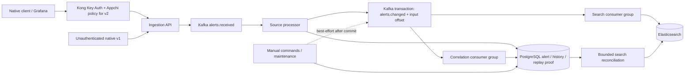

# Kafka-first alert pipeline

**Later user decision — 2026-09-30 (REV-35):** automatic directory synchronization is nice-to-have and is not deployed. Explicit trusted publication supplies identity updates; the five-minute LDAP-change propagation target is deferred. See [worker scope](spec-worker-scope.md#4-directory-synchronization-is-nice-to-have).

**Later scope correction — 2026-09-30:** [Worker scope](spec-worker-scope.md) (REV-34) supersedes timer-driven maintenance release, automatic assignment cleanup, inactivity/retention worker deployment and asynchronous operator provisioning below. Earlier automation algorithms are retained as deferred design references; unaffected authorization, explicit commands, history access and recovery safeguards remain normative.

Normative redesign accepted by the user on 2026-09-30 (REV-33). PostgreSQL remains
the alert, history, incident and configuration authority. This supplement governs
the alert transport, ordering and recovery contracts. Implementation and executed
evidence are tracked separately in [implementation status](https://github.com/appchi-alert-operations/appchi-delivery/blob/main/status/implementation-status.md)
and [the implementation record](https://github.com/appchi-alert-operations/appchi-delivery/blob/main/docs/kafka-first-implementation.md).

## 1. Authority and topology

Ingress never connects to Appchi PostgreSQL for authorization, routing, admission,
backlog checks or acknowledgement. Configure the immutable Global UUID for v1.
V2 accepts only verified private-mTLS gateway context. Native identity formulas,
strict native schemas, tenant ownership and the separate Grafana adapter remain.
No PostgreSQL inbox, received outbox, alert dispatch relay or CDC participates in
the new path. Legacy tables exist only for fenced drain, history and recovery.
Unrelated durable operator/configuration/retention jobs and live-view hints remain.

## 2. HTTP admission and receipt identity

Capture ingress UTC at request arrival, before body processing. Preserve it for
every accepted member and every internal attempt. Omitted native-v2 time_created
defaults to that instant at native whole-second precision; preserve defaulting
provenance and the exact original customer JSON separately.

**Assistant-selected HTTP contract:** retain single native objects and the existing
batch wrapper (`alerts`, members with `payload`). Optional Idempotency-Key and
member event_id retain their existing syntax validation but have no deduplication
meaning. No sender identifier is required. Remove the receipt lookup endpoint;
responses contain neither receipt tokens nor receipt URLs. A resubmission always
receives a new internal delivery UUID and new receive time.

Valid members publish concurrently as individual Kafka records. Make three total
publish attempts per member, stopping after the first confirmed acknowledgement.
Reuse the exact encoded bytes, delivery UUID and UTC receive time across attempts.
Use idempotent production, acks=all and at most five in-flight requests. Select a
one-second producer delivery timeout and a 1.1-second application attempt bound;
the three attempts fit inside the five-second handler budget, which includes body reading. Validation
and scheduling overhead must also fit that budget; the gateway timeout stays ten
seconds. Bound the existing 4 MiB request, 100 members and 64 KiB customer object.
Admission qualification must exercise cold connections, full batches and outages.

| Member outcome | Member status | Meaning |
|---|---|---|
| Broker confirmed | 202, accepted | Validated and durably accepted by Kafka |
| Validation rejected | 422, rejected | No publication attempted |
| Three unconfirmed attempts | 503, publish_failed, kafka_publish_unconfirmed, retryable | Publication may have happened; no acknowledgement guarantee |

Whole response: 202 if every member is accepted; 207 for mixed accepted and failed
members; 422 if every member fails
validation; 503 when at least one valid member exists and all valid publications
fail. The latter takes precedence over mixed validation failures. Results preserve
input indices. Envelope/authentication/media/size failures retain 400/401/403/413/415.
Request IDs are diagnostic IDs, not resubmission keys.

A 202 does not promise eventual PostgreSQL application. In particular Kafka
retention can expire an accepted, unprocessed receipt. There is no processor-lag
admission gate while Kafka continues acknowledging. Broker capacity, retention,
replication and availability guarantees belong to its operating team.

## 3. Kafka keys, fencing and two independent commits

**Assistant-selected encoding:** alerts.received internal schema version 2 contains
validated native payload, exact raw JSON, native version, time-default provenance,
internal delivery UUID, receive time and trusted operator/tenant/credential/policy
generation. Its key is canonical UTF-8 JSON `[tenant, application, key_field]`.
This partition key does not change either native logical-identity formula.
Concurrent ingress replicas establish append order, not UTC order. Partition counts
are immutable while the pipeline runs; changes require a fenced drain/cutover.

The source group disables automatic offset commits and stores. **Assistant-selected
batching (2026-10-18):** each turn takes at most 100 already-fetched inputs without
waiting; only an idle consumer waits, up to 100 milliseconds, for a single input.
Inputs are grouped by input partition and handled partition by partition in input
order:

1. For each input, validate internal scope, schema, key and identity proof. Under the
   tenant coordinator, recognize an existing delivery UUID or apply the source mutation.
2. For each input, commit current state, source/history/maintenance proof, and a
   source-result row in one PostgreSQL transaction. The row retains input digest, first
   topic / partition / offset, result and exact immutable changed-event bytes. Allocate
   application order here solely for before/after proof; it is not receive order.
3. Close the partition batch at its last fetched input or once 100 milliseconds of
   application have elapsed. Begin one Kafka transaction, publish the batch's changed
   events in input order keyed by tenant UUID bytes, send the last applied offset plus
   one with group metadata, then commit the Kafka transaction.
4. Record the batch's confirmation/progress in one PostgreSQL transaction. This last
   record is diagnostic and retention bookkeeping; the committed broker group offset
   remains offset authority.

The Kafka transaction begins only after its inputs are committed in PostgreSQL. A
transaction carries zero or more changed events; rejections and replays at another
coordinate emit none. Downstream consumers treat each changed record independently
and never assume one event per transaction. When an input fails in step 1 or 2,
complete steps 3–4 for the inputs before it, record the fault, then retain the failed
offset for that partition while other partitions continue.

Stable transactional IDs include environment, source protocol and input partition.
On assignment initialize that producer first, fencing the previous owner and
settling its uncertain transaction, then read committed offsets. On an uncertain
outcome recreate/rejoin; never blindly publish again on a stale assignment. The
uncertainty covers the whole batch: its inputs remain unconfirmed in PostgreSQL and
the next owner replays them from the committed offset. Both downstream groups use
read_committed. A PostgreSQL commit is never described as atomic with Kafka.

Replay at the original input coordinate returns the original immutable bytes,
even after intervening manual edits. The same delivery UUID at another coordinate
advances without reapplying or emitting another semantic changed event. Conflicting
content under an existing UUID is a visible protocol fault. A new client submission
has a new UUID; an unchanged logical repeat still updates receipt/history bookkeeping
without fresh correlation evidence.

Fixed-severity and other validated source business conflicts are terminal internal
post-202 rejections: retain a controlled reason and advance the input. Transient
authority/broker failures retain the offset. A receipt ahead of the tenant clock
within the clock-health bound is transient but records no fault; section 5 retains
its offset only for the measured lead. Malformed internal records and unknown
proof fence the partition for explicit repair; do not silently skip them.

## 4. Manual changes and correlation

Manual commands keep expected revisions, authorization, idempotency and no-op rules.
Remove source_updates_pending. A queued source delivery can apply after a manual
command and change the alert again. After a committed visible mutation, attempt a
best-effort changed notification for search. Notification failure cannot undo the
successful command or create a PostgreSQL alert dispatch queue.

Correlation consumes changed in tenant Kafka order using its own consumer group.
Its durable consumption sequence is separate from PostgreSQL change_order, which
still identifies historical before/after proof. Recheck current revision, fields,
status, suppression, ownership and reset/release boundaries before acting. Current
state may have advanced beyond the consumed source event. Ignored note/assignment
changes can advance evidence's observed revision only when correlation-visible
fields are unchanged.

Ignore manual edits as qualifying inputs. A real manual transition to resolved
atomically clears active evidence and sets a UTC release boundary, while preserving
incident links and incident status. Editing a note on an already resolved alert
does not move that boundary. Manual reopening cannot seed fresh evidence. A later
qualifying source transition can. Remove assignee_id from correlation conditions
and grouping, keeping it in search/feed and maintenance contexts.

**Assistant-selected migration:** inspect saved correlation programs with the actual
compiler and grouping catalog; preserve source/configuration/history, mark affected
rules blocked with correlation_field_removed, and clear their active evidence.
Do not silently reinterpret them or re-enable them. An explicit valid logic edit
or delete resolves the block; a corrected rule begins at a fresh epoch boundary.
String literals containing the field's spelling do not count as field references.

## 5. UTC, maintenance and bounded inline effects

**Assistant-selected tie rule:** UTC comparisons govern source eligibility. A source
exactly equal to a control activation, reset, manual release, disable or delete
boundary does not gain eligibility across that boundary. Scheduled coverage remains
start-inclusive/end-exclusive when activation strictly precedes receipt. Application
order proves state chains and never resolves cross-clock UTC ties.

**Assistant-selected clock-health contract:** the deployment must provide host clock
health for ingress, workers, PostgreSQL and Kong; absolute offset over one second,
an unavailable clock-health observation older than 60 seconds, or a backward decision
clock fences temporal actions on the affected workload. Preserve timestamps while
blocked. These are application thresholds to qualify, not infrastructure guarantees.
Even healthy clocks leave near-boundary uncertainty of the combined clock error;
UTC timestamps do not prove exact cross-service order. Kafka lag alone is not a
clock-health failure.

**Assistant-selected receipt lead (2026-10-19):** no source is applied before the
tenant decision clock reaches its receipt, so a later control boundary cannot precede
an applied receipt. When the clock read under the coordinator is earlier than the
receipt, the source processor rolls the application back before any write. Within the
one-second clock-health bound this is ordinary clock difference, not a fault: only
that input partition waits for the measured lead plus 10 milliseconds, and leads above
100 milliseconds log a warning. A larger lead records the `source_receive_time_ahead`
fault and uses the normal partition retry. Receipt is never replaced or moved.

Retain maintenance controls and full per-alert before/after lineage. Reduce field
chains in application order and compare each receipt to UTC coverage independently.
Do not backfill a window across its activation or substitute processing time for
receipt. Retain independent source and maintenance causes and overlap union proof.

Automatic release/retraction is part of each affected alert's PostgreSQL maintenance
transaction. Compile before locking; lock coordinator, window/rules/contexts, sorted
incidents, then the complete affected alert/evidence scope. Apply one complete alert
per transaction and yield after 100 alerts or 100 milliseconds between transactions.
Keep the existing control boundary and bounded durable fan-out jobs.

Retain stable qualifier UUID, original release time, source-origin input and validated
release snapshot. Manual-created suppression or manual resolve/reopen cannot manufacture
source eligibility at a later scheduled end. **Assistant-selected provenance:** a manual
input that itself closes the final suppression cause does not create a qualifier.
Scheduled/control release may use valid source transition proof, including a later
qualifying source after manual reset; a true-to-true repeat cannot substitute for that
proof. Inline maintenance may use source proof only after every source input already
applied to that alert through its current PostgreSQL state has reached correlation,
including unchanged repeats and later changes away from and back to the retained
release snapshot. Equality with the current fields alone is insufficient proof.
An older delayed release preserves a membership's later qualifying start and expiry;
it cannot move that membership backward to the release time. A delayed changed event
can use its associated historical release proof; it cannot inherit an unrelated
latest qualifier. Retract withdrawn qualifiers by stable ID. Unknown or stale current
suppression blocks automatic actions; missed Kafka notifications cannot create an action.

## 6. Search reconciliation, progress and rebuild

**Assistant-selected reconciliation:** continuously rotate tenants in bounded pages
of at most 50 permanent alert UUID identities, yielding between complete writes after
100 milliseconds. Begin another completed tenant pass no sooner than two seconds
later. This is a scheduling choice; full-pass duration and resulting latency require
capacity measurement. Prioritize direct Kafka hints but keep scanning during Kafka
outages. Scan authority, not pending projection-work flags.

**Assistant-selected hint batching (2026-10-22):** one search-hint turn hands the
first pending group of every busy changed partition, at most 500 hints in all, to
one projection request, so a single bulk of at most 500 documents and 4 MiB and one
refresh wait cover them. Each partition's offset advances only by its own covered
prefix after that bulk is acknowledged and search-visible. When the request fails or
does not reach the head partition, nothing from it is committed and the head
partition is handled alone, which keeps per-partition fault isolation and retries.
After a failed shared request, every non-head partition it included is left out of
shared requests until it has run alone once and its own batch succeeded (or it was
fenced or revoked), and no shared request is made while such a partition is the head.

At pass start capture committed projection sequence S. Keyset-scan UUID identities
and load each page's current alert, notes, links and owner under repeatable read.
Retired identities produce permanent versioned deletion markers. PostgreSQL mutations
atomically advance identity current_projection_seq and projection_version. ES external
version guards reject older state. Verify refresh-visible coverage; a newer document
is coverage only after authority verification. A concurrent identity inserted behind
the cursor has sequence above S; updates after a scanned page also exceed S. Only
completion of the entire pass can advance searchable_seq to captured S. Never advance
it to an end-of-pass maximum or to the maximum individual hinted document.

Return committed/searchable positions and verified time honestly. A lost notification
may leave search stale until reconciliation. Durable tenant view-state plus Redis/SSE
reconciliation remains the browser invalidation path.

Rebuild into a new physical index/epoch under a registered retention hold. Retained
immutable projection snapshots may prove a bounded snapshot and catch-up range; they
are reconstruction evidence, not the running indexer's polled dispatch queue. Capture
the rebuild boundary consistently, copy current state and tombstones, catch concurrent
commits, pause/fence physical-index writers, drain their leases, capture a final
boundary, verify full coverage/parity and atomically switch the alias. PostgreSQL
mutations continue; the new serving reconciliation repairs changes beyond the final
boundary. Never replay source lifecycle or correlation actions during rebuild.

## 7. Kong policy and provisioning

**Assistant-selected implementation:** package the Lua appchi-policy plugin with
Kong OSS Key Auth. Store a nonsecret operator policy in Kong's own PostgreSQL database,
with a monotonic generation and a trigger rejecting older or conflicting same-generation
writes. This is separate from Appchi PostgreSQL. Query policy without an authorization
cache; missing/unavailable/malformed policy fails closed. **Assistant-selected gateway errors:** inactive/prepared/revoked/expired credentials return 401; unavailable policy or clock proof returns 503. Prepared credentials deny.
Current credentials allow; retiring credentials require a fixed UTC expiry and deny
at equality or later. Denial policies persist across cleanup and stale worker retries.

The plugin validates immutable operator/tenant association, credential ID/state,
expiry and generation, strips untrusted identity/key headers, and supplies trusted
context over the pinned private-mTLS boundary. Grafana routing keeps exactly
`Appchi - {operator name}` with literal value `true`.

Provisioning first installs the credential and a deny policy, verifies preparation
and Grafana, then commits activation intent/current state with the fixed retiring
deadline. A separate phase distributes the active policy and verifies every serving
node before completion or Copy. Rename/cancellation also verify the final policy.
Revoke erases ciphertext immediately and returns pending until denial is verified;
updating Appchi PostgreSQL alone is not gateway revocation. Denial distribution runs
even when Grafana is unavailable. A denied credential needs no plaintext to prove
policy denial; active proof exercises actual Key Auth as well as policy.

Serving-pool proof is private and non-ingesting, bound to fresh nonce, operation and
policy generation, exact document digest, credential disposition/expiry, immutable
tenant and node-local identity. Verify all configured direct serving members; no
load-balanced sample or legacy identity-only fixture proves the pool. Fleet membership,
TLS, node clocks, installed version and authenticated management endpoints require
environment qualification. Production installation is outside this implementation task.

Trusted v2 context includes gateway authorization UTC and expires after ten seconds. Ingress enforces that lifetime as well as its five-second request deadline. Deletion additionally denies ingress, waits fifteen seconds after all-node denial (authorization lifetime, outstanding broker attempt and two-host clock uncertainty), captures received-topic end offsets and proves source progress through them
before the final retained-alert guard. It cannot rely on an empty old PG inbox.

## 8. Cutover, retention and diagnostics

**Assistant-selected cutover:** forward migrations preserve old tables and receipts.
Fence old ingress, drain its pending source/outbox/correlation/projection work with
the compatible old workers, then stop those workers. Capture topic boundaries and
initialize new protocol consumer groups there before admitting schema-2 records.
Record partition counts, offsets and protocol activation durably. Enable the separate immutable ingress configuration `APPCHI_KAFKA_ADMISSION_ENABLED=true` only after this succeeds; it defaults false and does not query PG. Never run legacy
relay/hint workers alongside the new source/correlation/index groups. Old receiver
credentials require the actual plugin/policy migration and all-node proof. Rollback
after new admission requires draining that protocol with compatible consumers; an
old ingress image cannot read the new Kafka records.

**Assistant-selected purge boundary:** a receipt at or before a retained logical-key
retirement UTC is terminally rejected even if acknowledged before retirement; a
later firing receipt can create a new UUID. This replaces the PG pending-target
check, which cannot enumerate unapplied Kafka inputs.

Keep minimal delivery UUID/digest/first-coordinate fences, changed-event identities,
retired alert identities and retired logical-key receipt boundaries through replay
and restore. Payload-bearing immutable source publication proof cannot be reclaimed
before broker offset confirmation; correlation proof and active rebuild holds also
apply. Physical cleanup never permits old receipts to recreate retired content.
Independent protected evidence must include the new replay/retirement boundaries.
Missing protected evidence keeps affected recovery paths closed. Maintenance timeline cleanup also remains held until a verified Kafka retention/replay boundary is supplied; no time-only inference releases that hold.

The old PG processing/retry endpoint is fenced after cutover. Tenant health reports Kafka processing as not_measured instead of treating the empty legacy inbox as healthy. The bounded global-admin Kafka endpoint exposes sanitized rejection/fault/observed-position and search-pass snapshots. Environment monitoring must additionally collect broker-authoritative offsets and low watermarks, since PG diagnostic observations can lag broker commits. Record terminal source rejection, consumed/committed offsets, oldest receive age,
partition lag, low watermarks, retention gaps and bounded reconciliation progress.
No diagnostic response exposes credentials or substitutes a client receipt endpoint. A source arriving after completed operator deletion is terminally rejected, including late unconfirmed broker writes; all acknowledged inputs must have crossed the deletion drain barrier.
An offset below the broker low watermark is an explicit loss interval. Source and
correlation stop for audited recovery/reset; indexer can rebuild from PostgreSQL and
resume at available offsets. Do not claim zero acknowledged loss from Kafka retention
expiry. Source history already committed in PostgreSQL remains authoritative.

Qualification covers the crash matrix around both commits, unknown commits, rebalances,
duplicate UUIDs at different offsets, resubmissions, source conflicts, PostgreSQL-down
ingress, Kafka-down retries, queued-source/manual races, lost search notifications,
inline maintenance provenance, saved-rule migration, purge/restore/rebuild, clock
faults, serving-pool propagation and retention gaps. Actual results belong in delivery
evidence; passing local tests does not establish production readiness.

## 9. Isolated cluster initialization tools

**User request — 2026-10-05:** implement the initial search activation and operator
proof helpers required for the isolated private OpenShift load-test deployment.
This adds deployable tooling under the existing search/provisioning contracts;
it does not qualify a production environment or reintroduce deferred workers.

**Assistant-selected search boundary:** initial activation is an explicit,
development-only command owned by the indexer. Require verified HTTPS, current
host/database clock evidence, an explicit index/alias allocation, exclusive
alias-writer agreement, stopped ingestion/writers and a fresh empty authority.
Execute live disposable capability probes on the configured ES target and bind
their observations to the deployment, physical index, epoch, mapping and binding.
Reserve a durable exact intent before creating the serving index. Resume only
matching owned resources, and refuse populated/conflicting/restored state.
Recheck authority/progress under write-excluding SQL locks before atomically
recording empty-tenant visibility and enabling the initial search gate. Existing
rebuild/restore procedures retain their separate prerequisites.

**Assistant-selected proof packaging:** a private request-driven HTTPS helper
uses the API image and a bounded read-only SQL pool. It validates the configured
fixed member set against the API's operator binding, checks current operation,
lease and policy evidence before/after direct member calls, and returns only
validated nonsecret proof. Supplied selected-key material must match the SQL
verifier and traverse real Key Auth; unavailable plaintext for an old/revoked
credential permits only explicitly identified policy proof. No request admits an
alert or starts background provisioning. In the isolated test bundle, singleton
Kong uses ordinal DNS; replacement/scaling requires renewed node inventory and
binding verification. These choices do not establish fleet/HA guarantees.
